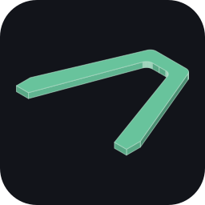
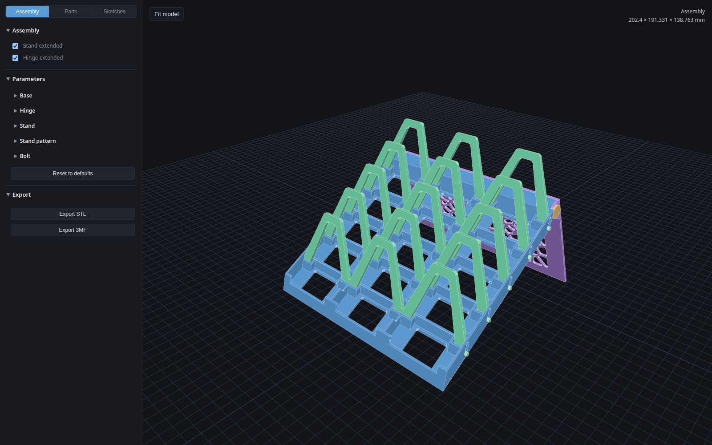

<p align="center">
  
</p>

<h1 align="center">cards stand</h1>

<p align="center">Parametric cards stand generation for board games</p>

<p align="center"><a href="https://ivanlukomskiy.github.io/cards-stand/">Open the generator</a></p>

## How it works

The stand is a grid of cells that hold cards, with a hinged divider in each row and a folding stand at the back. You set the dimensions in the sidebar (rows, columns, cell size, wall thickness, angles, tolerances and the stand's Voronoi pattern), and every part is rebuilt from them:

- **Base**: the cells, with grooves the hinges rotate in, and the end that holds the stand.
- **Hinge**: one per row, holding the cards up.
- **Stand**: the folding back support, with a rounded Voronoi pattern cut through its plate.
- **Bolt**: two pins that hold the stand in the base.

Each part is described by 2D sketches computed in TypeScript (shown in the Sketches view, with every point's formula on hover). The sketches are extruded and combined by OpenSCAD, running in the browser as WebAssembly, and the resulting meshes are shown with Three.js. The Assembly view puts the parts together, with the stand and hinges folded or extended. Export downloads every part as STL or as 3MF with the assembly colours, ready to slice and print.



## Running locally

Use Node.js 24.

```sh
npm install
npm run dev
```

## Why

This project is an experiment in designing a printable model by writing code with AI tools instead of using CAD software. Every dimension, sketch and part is described in conversation and turned into TypeScript and OpenSCAD, with tests that check the real geometry. Whether a design changes or a print shows a part is too tight, the fix is a change to the model's rules, and every part follows from them.

## License

[MIT](LICENSE). The bundled OpenSCAD runtime in `public/vendor/openscad` is GPL-licensed (see its `COPYING`).
